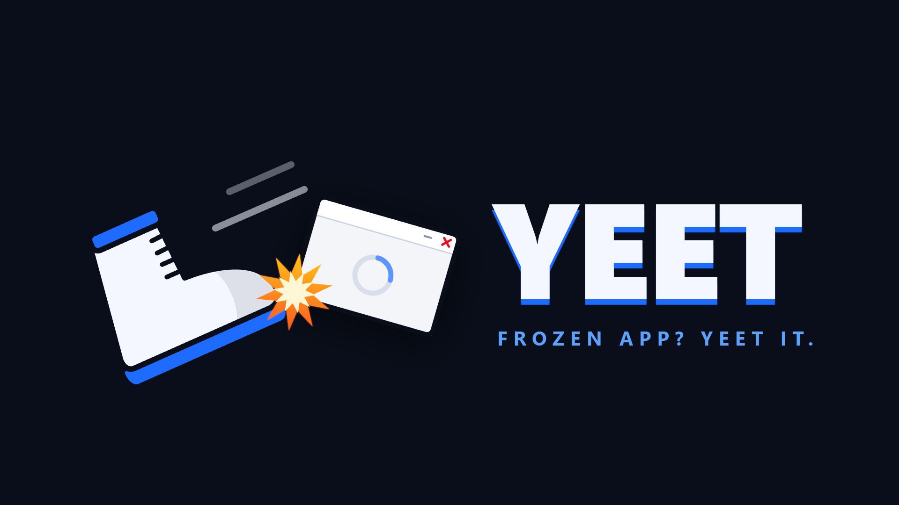
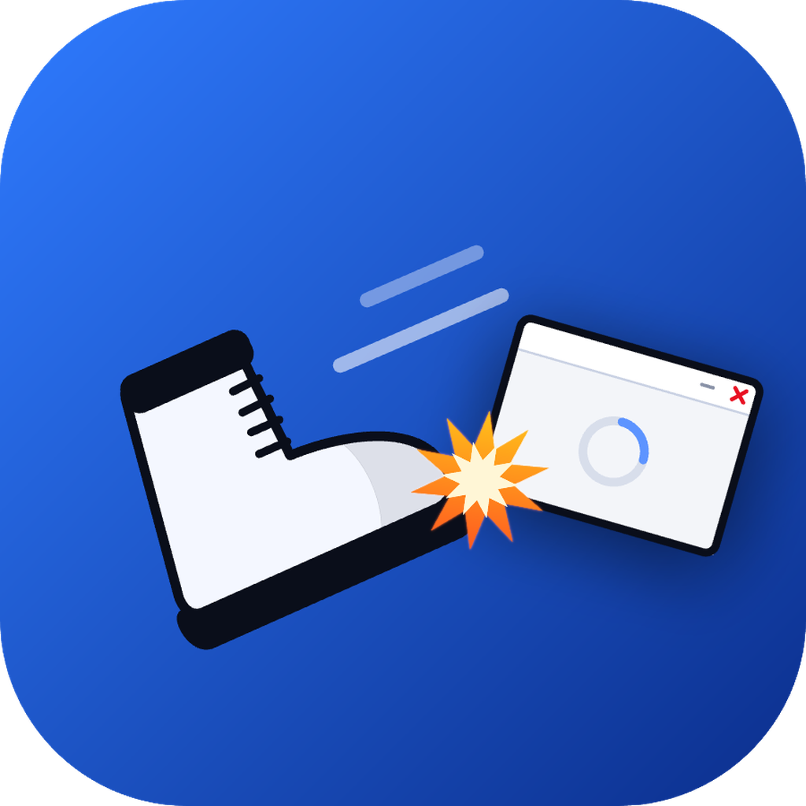

<div align="center">





# Yeet

**Frozen app? Yeet it.**

The Windows 11 taskbar "End task" button, brought to Windows 10.<br>Shift + right-click any taskbar button → **End task** → gone.


</div>

---

## What it does

Windows 11 lets you kill a frozen app straight from the taskbar. Windows 10 makes you open Task Manager.
Yeet is a tiny background tool that adds that missing option:

1. Hold **Shift** and **right-click** an app's taskbar button.
2. Pick **End task (app.exe)**.
3. The app is asked to close politely. If it's still running 2 seconds later, it's force-closed.

No window, no settings screen, no install. It lives in the system tray.

## Features

- **Works on grouped buttons.** If a button holds windows from several processes, each one gets its own item, so you choose exactly what to end.
- **Feels native.** The menu opens just above the taskbar like Windows' own menus, on top of thumbnail previews, and closes the preview the way a real click does.
- **Doesn't fight the taskbar.** A plain right-click still works as usual. Only Shift + right-click is handled.
- **Forgiving clicks.** Clicking in the small gap between two icons still picks the right button.
- **Multi-monitor.** Works on the main taskbar and on taskbars on other screens.
- **Lightweight.** One small native exe, no runtime, no services.

## What can and can't be ended

Yeet only offers End task for normal apps that have a window on the taskbar.
If an app can't be ended, **no menu appears at all**.

### ✅ Can be ended

Any regular desktop app with a visible taskbar window, for example:

| Kind | Examples |
|---|---|
| Classic desktop apps | Notepad, Paint, Calculator |
| Browsers | Chrome, Edge, Firefox, Brave |
| Electron and chat apps | Discord, Slack, Spotify, VS Code |
| Games and launchers | Steam, Epic Games Launcher |
| Creative tools | Blender, DAWs, editors |

### 🛡️ Never ended (protected)

These are core parts of Windows. Ending them can crash the desktop, log you out or freeze the PC, so they're always skipped:

| Process | What it is |
|---|---|
| `explorer.exe` | Taskbar, Start menu and File Explorer |
| `csrss.exe` | Client/Server Runtime (critical system process) |
| `wininit.exe` | Windows startup and session init |
| `winlogon.exe` | Sign-in and lock screen |
| `services.exe` | Service Control Manager |
| `lsass.exe` | Security and authentication |
| `smss.exe` | Session Manager |
| `svchost.exe` | Host for Windows services |
| `dwm.exe` | Desktop Window Manager (draws the screen) |
| `sihost.exe` | Shell Infrastructure Host |
| `fontdrvhost.exe` | Font driver host |
| `ctfmon.exe` | Text input and language bar |
| `runtimebroker.exe` | App permission broker |
| `taskhostw.exe` | Task host for background tasks |

Also never ended: the System Idle Process (PID 0), System (PID 4), and Yeet itself.

### 🚫 No menu shown

- Empty taskbar space, the Start button and the tray area
- Pinned apps that aren't running
- Apps with no visible window
- Buttons whose process Windows won't let us inspect

> Apps running as administrator can only be force-closed if Yeet is also running as administrator.

## Install

1. Download `yeet.exe` from [Releases](../../releases), or build it yourself (below).
2. Put it anywhere you like and run it. An icon appears in the system tray.
3. Optional: right-click the tray icon → **Start with Windows**.

### Tray menu

| Item | What it does |
|---|---|
| **Enabled** | Turn the Shift + right-click menu on or off |
| **Start with Windows** | Run automatically when you sign in (per user, no admin needed) |
| **Uninstall** | Removes the startup entry, deletes the exe and exits |
| **Exit** | Quit until next start |

## Build from source

Requires [Rust](https://rustup.rs) (stable, MSVC toolchain).

```powershell
git clone https://github.com/Neo664evr/yeet.git
cd yeet
cargo build --release
```

The exe is written to `target\release\yeet.exe`.

## How it works

```
Shift + right-click on taskbar
        │
        ▼
Low-level mouse hook (own thread) ── swallows the click, returns instantly
        │  posts a message
        ▼
Hidden window
  ├─ UI Automation: read every taskbar button's rectangle, pick the one under the cursor
  ├─ Match the button name to its top-level windows → process IDs
  ├─ Drop protected processes (nothing left → show nothing)
  └─ Show the End task menu above the taskbar
        │  clicked
        ▼
WM_CLOSE to the app's windows ──(2 s, background thread)──▶ TerminateProcess if still alive
```

- The hook only decides whether to swallow the click. All real work happens elsewhere, so mouse input never lags.
- The hidden window is a normal window, not message-only, so it gets the `TaskbarCreated` broadcast and re-adds its tray icon if Explorer restarts.
- A named mutex keeps only one copy running.

## Notes

- Ending an app this way skips its "save changes?" prompt after 2 seconds, so unsaved work in that app is lost, just like Task Manager's End task.
- Button names are read in English form (`"App - 2 running windows"`). Other display languages may match fewer grouped buttons.

## License

[MIT](LICENSE)
